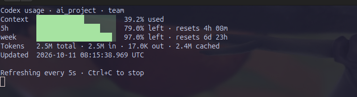

<div align="center">

# ⚡ Codex Usage Monitor

**A privacy-first, zero-dependency observability dashboard for OpenAI Codex CLI.**

Track context pressure, five-hour and weekly usage limits, reset countdowns, and token consumption—directly from your terminal.

[](https://www.python.org/)
[](#why-codex-usage-monitor)
[](#privacy)
[](LICENSE)



</div>

## Why Codex Usage Monitor?

Long-running agentic coding sessions make it easy to lose track of context pressure or hit a usage window at the wrong moment. Codex Usage Monitor turns Codex's local session telemetry into a fast, human-friendly terminal dashboard—without an API key, cloud service, daemon, database, or extra package.

- **Real-time AI observability** — live context and usage-window visibility
- **Quota intelligence** — remaining five-hour and weekly capacity at a glance
- **Reset forecasting** — countdowns show when each window renews
- **Token analytics** — total, input, output, and cached token counters
- **Developer-native UX** — snapshots, watch mode, colors, and JSON output
- **Privacy by design** — local, read-only processing with no telemetry upload
- **Automation-ready** — structured data for scripts, widgets, and dashboards
- **Zero dependencies** — one Python file powered by the standard library

## Quick start

Requirements: Python 3.11+ and Codex CLI with at least one completed turn.

```bash
git clone https://github.com/MBaranekTech/codex-usage-monitor.git
cd codex-usage-monitor
python3 codex_usage.py show
```

Start the live dashboard:

```bash
python3 codex_usage.py watch
```

It refreshes every five seconds and rings the terminal bell when a usage window falls below 10% remaining.

## Commands

### One-time snapshot

```bash
python3 codex_usage.py show
```

Disable ANSI colors when redirecting output:

```bash
python3 codex_usage.py show --no-color
```

### Live monitoring

```bash
python3 codex_usage.py watch
```

Customize the refresh interval and low-quota alert:

```bash
python3 codex_usage.py watch --interval 2 --alert-below 15
```

### JSON output

```bash
python3 codex_usage.py show --json
```

Use JSON output with shell scripts, status bars, Grafana collectors, desktop widgets, or internal developer-experience tooling.

### Custom Codex home

```bash
python3 codex_usage.py --codex-home /path/to/.codex show
```

The standard `CODEX_HOME` environment variable is also supported.

## Native Codex status line

The repository also includes a safe configurator for Codex's built-in footer:

```bash
python3 codex_statusline.py install
```

The default preset enables model, project, context usage, and five-hour/weekly limits:

```toml
[tui]
status_line = ["model-with-reasoning", "project-name", "context-used", "five-hour-limit", "weekly-limit"]
status_line_use_colors = true
```

Available presets:

```bash
python3 codex_statusline.py install --preset compact
python3 codex_statusline.py install --preset git
python3 codex_statusline.py install --preset full
```

The installer validates TOML, preserves unrelated settings, and creates a timestamped backup before changing an existing `~/.codex/config.toml`.

```bash
python3 codex_statusline.py doctor
python3 codex_statusline.py uninstall
```

## How it works

Codex records token-count events and rate-limit snapshots in local JSONL session files. The monitor finds the newest session, reads its latest usage event, and renders the data as a snapshot or continuously refreshing terminal UI.

```text
~/.codex/sessions/**/*.jsonl
             │
             ▼
      read-only parser
             │
             ├── terminal dashboard
             ├── live watch mode
             └── JSON output
```

Context percentage uses the latest turn's active token count, while the token summary reports cumulative session totals. Rate-limit values are displayed as reported by Codex.

## Privacy

- No authentication files are opened
- No API keys or OAuth tokens are required
- No network requests are made
- No usage data leaves your machine
- No background service is installed
- Session files are opened read-only

The local Codex session-event format is not a documented stable API and may change in future Codex releases. This project is a local developer utility, not a billing or compliance ledger.

## Development

```bash
python3 -m unittest discover -s tests -v
```

The test suite covers configuration preservation, multiline TOML replacement, JSONL parsing, malformed records, latest-session selection, rate-limit mapping, context calculation, and reset countdowns.

## Roadmap

- Per-project usage history and trends
- Burn-rate forecasting before quota exhaustion
- macOS and Linux desktop notifications
- Shell prompt and tmux integrations
- Exporters for developer productivity dashboards

## License

[MIT](LICENSE) © 2026 MBaranekTech

---

<div align="center">
Built for developers who want visibility into their AI coding workflow.
</div>
